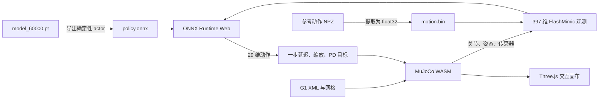

# FlashMimic 浏览器交互仿真

网站在 `main` 分支开发，服务于旁边的 `FlashMimic` 项目。当前接入
`logs/g1_batch_v1` 的五个独立 FlashSAC 策略：舞蹈、翻转、跑步、冲刺、行走。

## 实现方法

[UniLab 参考站](https://unilabsim.github.io/#demos) 的
[加载脚本](https://unilabsim.github.io/scripts/motrixsim_roving.js) 使用一个共享的
MotrixSim / Bevy WASM 画布，点击卡片后加载场景和 ONNX 策略，再在卡片之间移动画布。
它通过 `motrixsim:switch`、`motrixsim:ready` 和 `motrixsim:visibility` 消息管理示例。
只更换 ONNX 文件无法迁移 FlashMimic 自定义观测。

本站沿用点击加载、单画布和离屏暂停的交互方式，物理后端采用
[官方 MuJoCo WebAssembly](https://github.com/google-deepmind/mujoco/tree/3.11.0/wasm)，
与本批训练环境同为 3.11.0。Three.js 渲染机器人，ONNX Runtime Web 在 CPU WASM
上执行策略，不调用远程推理服务。训练、导出需要 Python，访问者运行 demo 不需要。



模型采用 `FlashSACActor.as_export_module()`，输出 `tanh(mean)`，保留网络自身的归一化层。
本批配置没有额外的观测归一化器。网页不加载 critic、优化器或原始 45 MB checkpoint。

## 控制契约

| 项目 | 当前值 |
| --- | --- |
| 机器人 / 引擎 | G1 29 DOF / MuJoCo 3.11.0 |
| 物理步长 | 1/150 秒 |
| 控制步长 | 1/50 秒，每次推理后执行 3 个物理子步 |
| 策略输入 / 输出 | `obs: [1,397]` / `action: [1,29]`，float32 |
| 观测顺序 | 上次动作 29、参考根位置 24、参考根旋转 48、参考关节 232、躯干角速度 3、重力传感器 3、关节位置 29、关节速度 29 |
| 参考帧偏移 | `[-8,-4,-2,0,1,2,3,4]`，在动作两端截断 |
| 关节位置观测 | 绝对关节位置；本批默认偏差为零，不减站立姿态 |
| 重力观测 | 负 `pelvis_upvector`，保持训练传感器定义 |
| 目标控制 | 站立姿态 + 2 × 上一个控制步的动作 |
| 初始状态 | 第 0 帧参考根位置、四元数、速度和关节状态 |
| 结束 | 动作末尾或与训练对应的躯干 / 末端跟踪阈值触发重置 |

网页展示采用无观测噪声、无随机质量 / 摩擦 / PD 增益的标称环境，从动作起点开始，
运行完整动作，不采用训练时的随机起始帧和 10 秒 episode timeout。
因此它是训练策略的浏览器部署展示，不是训练环境的完整复刻或性能评估。
“施加扰动”向骨盆施加 100 ms 的世界坐标系水平外力（X 方向 160 N、Y 方向 50 N）。橙色箭头沿推力方向指向骨盆质心，施力结束后约 600 ms 淡出；淡出只是视觉提示，不延长物理施力时间。暂停时禁用扰动按钮。
浏览器算力不足时仿真会慢于墙钟时间，物理与控制步长保持固定。

## 更新模型

在网站目录执行（不修改训练项目和原始日志）：

```bash
npm ci --ignore-scripts
npm run prepare:web

/home/pc825/ws/lzy/FlashMimic/.venv/bin/python scripts/export_web_demos.py \
  --project /home/pc825/ws/lzy/FlashMimic \
  --runs /home/pc825/ws/lzy/FlashMimic/logs/g1_batch_v1
```

导出脚本为每个任务选择编号最大的 `model_*.pt`，从同一 run 读取
`resolved_config.yaml`，检查观测顺序、关节顺序、动作缩放、延迟、频率和 NPZ 对应关系。
若换了训练结构或控制配置，先更新适配器，再导出；不要跳过这些检查。
`manifest.json` 记录模型、配置和动作文件的 SHA-256，以及 ONNX 数值误差。

导出产物直接位于 `assets/sim/`。已有 `play_video.mp4` 复制到 `assets/videos/`，
只用作独立的“观看录制视频”链接。缩略图位于 `assets/images/`。
`site-content.js` 的 demo `id` 必须对应 manifest 的任务 ID。

缩略图可使用实际网页仿真截图，或从录制视频抽帧。当前冲刺封面采用网页仿真截图
`G04_sprint.png`，其余四个封面来自视频。更新录制视频后，可用 ffmpeg 生成同样构图
的缩略图（当前视频为 1280×720）：

```bash
for job in G01_dance G02_flip G03_run G05_walk; do
  ffmpeg -ss 0.05 -i "assets/videos/$job.mp4" -frames:v 1 \
    -vf "crop=640:400:320:200,scale=800:500" -y "assets/images/$job.webp"
done
```

```bash
/home/pc825/ws/lzy/FlashMimic/.venv/bin/python scripts/validate_observations.py \
  --project /home/pc825/ws/lzy/FlashMimic
node scripts/validate-sim.mjs /tmp/flashmimic-sim-validation.json
python3 -m http.server 8000 --bind 127.0.0.1
```

验证脚本分别比较真实 Python 观测函数和 JavaScript 实现，以及在与网页相同的
MuJoCo WASM + ONNX WASM 中运行完整闭环、动作延迟、扰动和重置。
导出还对每个策略进行 32 组 PyTorch / ONNX 对比，超过 `1e-4` 即失败。
网页端另外检查策略切换、暂停、语言切换、筛选及窄屏布局。

## 部署

这是纯静态网站，提交 HTML、JS、CSS 和 `assets/` 后可按原仓库设置部署到 GitHub Pages。
所有运行时依赖固定版本并随网站提供，不依赖第三方 CDN 或 UniLab 参考站的在线模型。
MuJoCo 使用单线程版本，ONNX 设置 `numThreads=1`，不需要 COOP / COEP 响应头。
需要支持 WebAssembly 和 WebGL 的现代浏览器。

当前素材总计约 69 MiB，首次打开某个 demo 需要加载约 44 MiB 未压缩资源
（共享引擎、机器人和一个策略 / 动作），其余策略每个约 2 MiB；主页只先加载缩略图。
服务器启用压缩和浏览器缓存后网络传输量可能更小。若无法运行，页面提供重试和视频链接。

## 文件

| 文件 | 职责 |
| --- | --- |
| `demo-player.js` | 卡片、加载状态、共享画布、暂停与离屏管理 |
| `simulation/viewer.mjs` | 按需加载 WASM / ONNX，Three.js 渲染与视角控制 |
| `simulation/controller.mjs` | 传感器读取、动作延迟、物理子步、扰动与重置 |
| `simulation/observations.mjs` | 397 维观测、四元数与参考动作索引 |
| `scripts/export_web_demos.py` | 导出、配置检查、轨迹打包和数值验证 |
| `scripts/prepare-vendor.mjs` | 从锁定 npm 依赖准备静态运行时 |
| `assets/sim/manifest.json` | 运行配置与模型来源记录 |
| `assets/vendor/NOTICE.md` | 第三方来源与许可证 |

## 展示排版与真机视频

演示区先展示真机舞蹈与行走，再展示五个交互仿真。桌面端采用两列等宽卡片，
仿真预览区固定为 340 px 高，卡片信息区固定为 150 px 高；启动仿真不跨列或放大。
宽度不超过 760 px 时改为单列，仿真预览区为 300 px 高，避免手机横向溢出。

真机视频为 `assets/videos/G1_dance_real.mp4` 和 `G1_walk_real.mp4`，
在 `site-content.js` 中配置为 `type: "video", category: "real"`。
使用原生播放控件，不自动播放；竖屏画面完整显示在固定高度区域中，不裁切。
封面位于 `assets/images/G1_dance_real.webp` 和 `G1_walk_real.webp`。
播放另一个视频或切换分类时，会暂停原来的视频。
